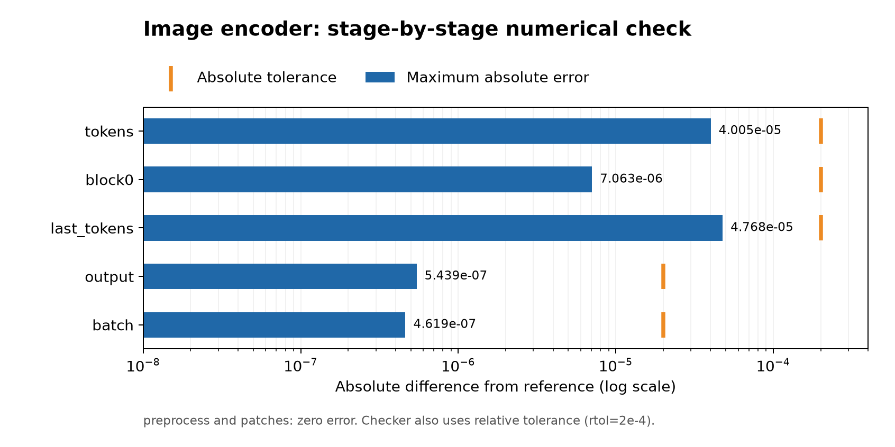

# NumPy 图像编码器｜Python Project 1

> 以 12 道 NumPy 练习为基础，复现 OpenCLIP ViT-B-32 图像编码器的前向计算，并逐阶段与课程提供的 FP32 参考结果核对。

**课程：** Python 程序设计　·　**实现：** NumPy　·　**结果：** 本地全阶段数值检查通过

## 项目概览

输入图像经预处理后形状为 `(B, 3, 224, 224)`，输出为每张图对应的 **512 维单位向量**。项目实现了图像块提取、token 构造、12 层 Transformer、CLS 提取、投影和归一化。

```text
图像 (B,3,224,224)
    → 49 个图像块 (B,49,3072)
    → 加入 CLS 的 token (B,50,768)
    → 12 层 Transformer (B,50,768)
    → 投影并归一化 (B,512)
```

## 数值验证



图中误差来自本地运行 `python check.py --stage all` 的结果，比较对象为课程参考输出。横轴为对数刻度；`preprocess` 和 `patches` 的最大绝对误差均为 **0**，故未绘入对数坐标。橙色标记是绝对容差；检查器还使用相对容差 `rtol=2e-4`。各阶段均通过检查。

| 阶段 | 结果形状 | 最大绝对误差 | 平均绝对误差 |
|:--|:--|--:|--:|
| preprocess | `(10, 3, 224, 224)` | `0` | `0` |
| patches | `(2, 49, 3072)` | `0` | `0` |
| tokens | `(2, 50, 768)` | `4.005e-05` | `1.289e-06` |
| block0 | `(2, 50, 768)` | `7.063e-06` | `3.250e-07` |
| last_tokens | `(2, 50, 768)` | `4.768e-05` | `2.696e-06` |
| output | `(10, 512)` | `5.439e-07` | `8.311e-08` |
| batch | `(3, 512)` | `4.619e-07` | `7.632e-08` |

上表是一次运行的观测值，末位数字可能随环境变化。中间阶段的最大绝对误差可能大于绝对容差，最终是否通过须按检查器逐元素的绝对与相对容差联合判定。

## 文件导航

| 路径 | 用途 |
|:--|:--|
| [`image_encoder.py`](image_encoder.py) | NumPy 图像编码器的核心实现 |
| [`numpy_homework.py`](numpy_homework.py) | 8 道基础题与 4 道中等题的合并版本 |
| [`lecture-demos/my_numpy_homework/`](lecture-demos/my_numpy_homework/) | 12 道练习的独立代码 |
| [`report/main.tex`](report/main.tex) | 实验报告源文件，用 XeLaTeX 编译 |
| [`output/pdf/project1_experiment_report.pdf`](output/pdf/project1_experiment_report.pdf) | 4 页实验报告 PDF |
| [`SUBMISSION_README.md`](SUBMISSION_README.md) | 提交说明与辅助工具披露 |
| [`docs/ASSIGNMENT.md`](docs/ASSIGNMENT.md) | 课程原始任务说明 |
| [`docs/plot_errors.py`](docs/plot_errors.py) | 误差图绘制脚本 |

## 复现方法

在项目根目录运行，要求 Python 3.9 或更高版本：

```bash
python -m pip install -r requirements.txt
python numpy_homework.py
python check.py --stage all
python run.py --output output_tokens.npz
```

`run.py` 也支持自定义图片：

```bash
python run.py --images path/to/a.jpg path/to/b.png --output my_tokens.npz
```

**课程数据：** 公开仓库未收录课程原始附件的 `weights/` 和 `assets/`。执行完整检查或图像编码前，需把这两个目录放回项目根目录；其中包含模型参数、测试图片和参考结果。仅重新生成误差图时无需课程数据：

```bash
python -m pip install matplotlib
python docs/plot_errors.py
```

报告 PDF 可用 `python -m pip install reportlab` 安装绘图依赖后，执行 `python report/generate_report.py` 重新生成。

## 实现要点

- 图像块经过 reshape 和 transpose，以行优先顺序形成 `(B, 49, 3072)`；加入 CLS 后形成 `(B, 50, 768)`。
- 分阶段检查预处理、图像块、初始 token、首层 block、最终 token、输出和批处理，便于定位误差。
- 最终输出按行归一化为 512 维向量，供后续图像与文本特征比较。

详细方法和误差分析见 [`report/main.tex`](report/main.tex)。课程 starter、检查器及辅助工具的使用情况见 [`SUBMISSION_README.md`](SUBMISSION_README.md)。
